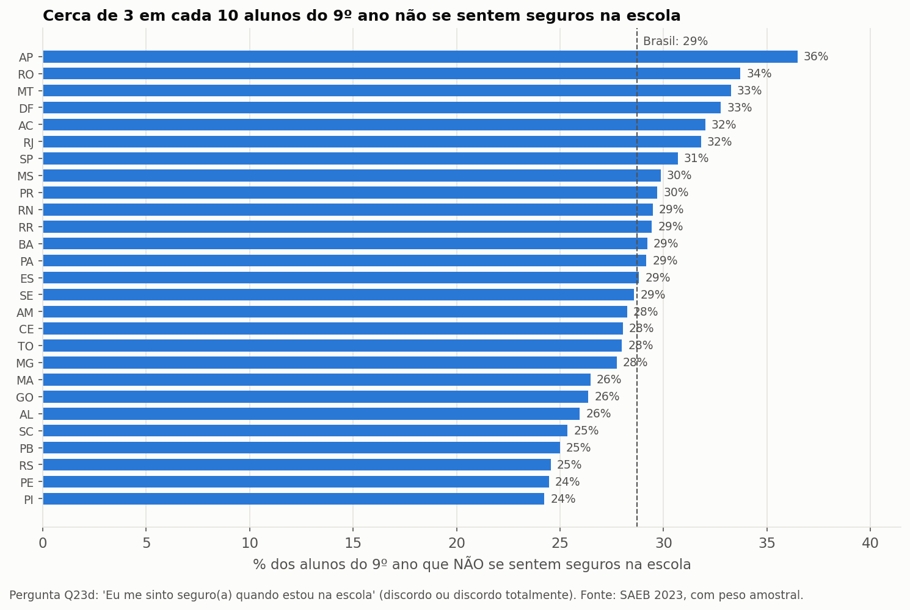
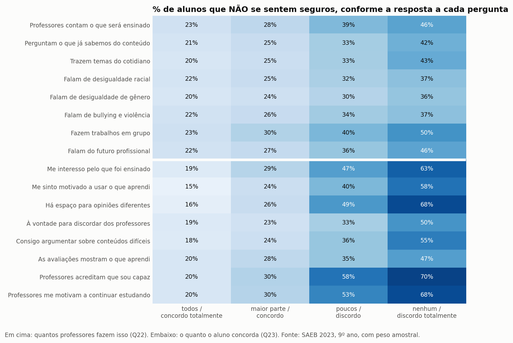
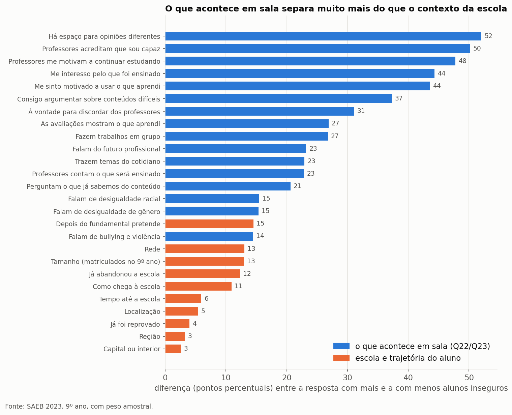
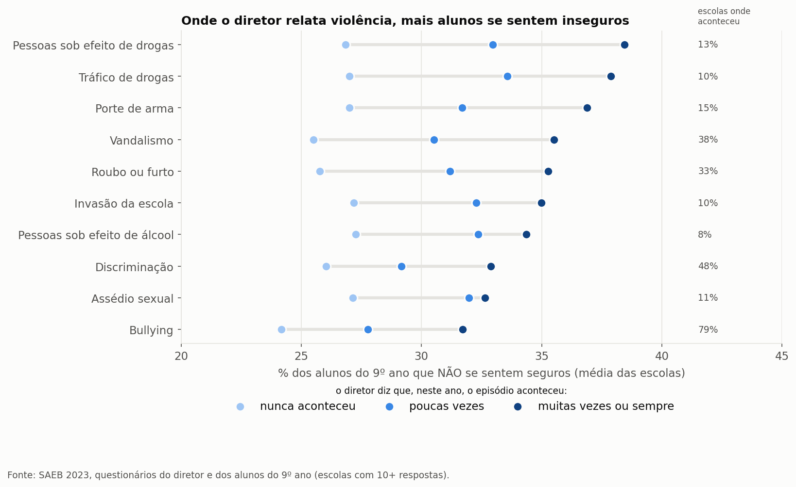
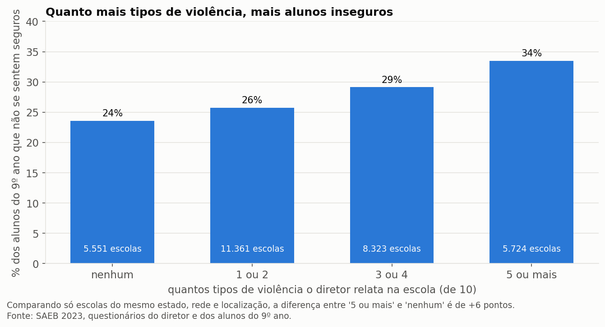
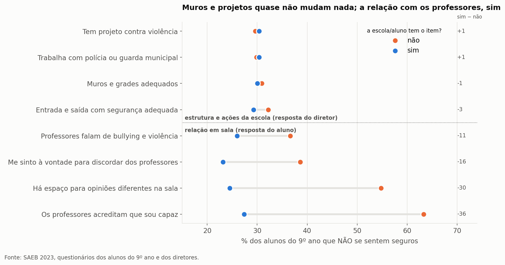
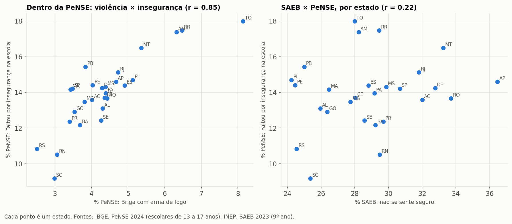

# Segurança na escola

**Pergunta:** os alunos se sentem seguros na escola? O que está ligado a isso?

**Resposta curta:** cerca de 3 em cada 10 alunos do 9º ano não se sentem seguros na escola. A violência relatada por diretores e professores está ligada a isso. Mas o que mais acompanha a sensação de segurança é a **relação em sala** com os professores, não muros, polícia ou projetos. Os padrões gerais se confirmam em outra pesquisa, a **PeNSE 2024 do IBGE**.

Análise feita no notebook `seguranca_escola.ipynb`. Figuras e tabelas na pasta `resultados_seguranca/`.

## Dados
Três questionários do SAEB 2023, ligados pelo código da escola (`ID_ESCOLA`), e uma pesquisa externa para validar (PeNSE 2024):

| Tabela | Colunas | Respostas |
|---|---|---|
| Alunos | `TX_RESP_Q23d` "Eu me sinto seguro(a) quando estou na escola" (**resultado**: discorda = não se sente seguro) | 1,94 mi (5º) · 2,00 mi (9º) · 1,47 mi (3ª EM) |
| | `TX_RESP_Q22f` professores falam de bullying · `Q23c` espaço para opiniões · `Q23e` à vontade para discordar · `Q23h` professores acreditam que sou capaz | ~2,0 mi no 9º |
| Diretores | `TX_Q093`–`TX_Q102` frequência de 10 tipos de violência · `Q082` aulas interrompidas por violência · `Q104` entrada/saída · `Q105` muros/grades · `Q123` polícia/guarda · `Q196` projeto contra violência | 61.870 escolas |
| Professores | `TX_Q135`–`TX_Q147` frequência de violência, incluindo lesão corporal e tiroteio | 128 mil professores do 9º ano |
| Alunos (outras variáveis, parte 2) | região, rede, localização, capital/interior, tamanho da escola · `Q14` tempo até a escola · `Q16` como chega · `Q19` reprovação · `Q20` abandono · `Q24` planos · `Q22a`–`h` e `Q23a`–`i` (sala de aula) | 1,87 a 1,99 mi no 9º |
| **PeNSE 2024 (IBGE)** | % de escolares de 13 a 17 anos que faltaram por insegurança na escola e no caminho, brigas, briga com arma de fogo, agressão | 27 estados, 5 regiões, rede |

- Não usamos nota e não comparamos alunos por cor, sexo ou renda. As comparações são entre **escolas** e **o que acontece nelas**.
- O questionário do diretor aparece uma vez por série avaliada. Deixamos **uma linha por escola**.
- Nas partes 3 e 4 cada escola é uma unidade: usamos a % de alunos do 9º ano que não se sentem seguros, em ~31 mil escolas com 10 ou mais respostas.

## 1. Quantos não se sentem seguros

| Série | % não se sente seguro | % discorda totalmente |
|---|---|---|
| 5º ano | 19,8% | 6,9% |
| 9º ano | **28,7%** | 7,9% |
| 3ª série EM | 25,5% | 6,4% |

- Entre os estados, vai de ~24% (PI, PE) a ~36% (AP). DF, RJ e SP ficam acima da média.
- Escola pública: 31%; privada: 18%. Urbana: 29%; rural: 24%.
- Em 5% das escolas, **metade ou mais** dos alunos não se sente segura.

## 2. A variável alvo e as demais variáveis
Como os alunos do 9º ano responderam à Q23d (incluindo quem deixou em branco):

| Série | Concordo totalmente | Concordo | Discordo | Discordo totalmente | Em branco |
|---|---|---|---|---|---|
| 5º ano | 33,4% | 29,7% | 11,0% | 5,5% | 20,4% |
| 9º ano | 15,6% | 40,4% | 18,1% | 6,4% | 19,5% |
| 3ª série EM | 13,3% | 41,9% | 15,8% | 4,9% | 24,1% |

No 9º ano, só 1 em cada 6 alunos concorda **totalmente** que se sente seguro.

**% de alunos do 9º ano que não se sentem seguros, por variável** (tabela completa em `resultados_seguranca/alvo_por_variavel.csv`):

| Variável | Menos inseguros | Mais inseguros | Diferença |
|---|---|---|---|
| Tamanho da escola (matriculados no 9º ano) | até 30: 23,0% | mais de 240: **36,0%** | 13,0 |
| Rede | privada: 17,8% | pública: 30,8% | 13,0 |
| Localização | rural: 23,8% | urbana: 29,2% | 5,4 |
| Região | Sul: 26,8% | Sudeste: 30,1% | 3,2 |
| Capital ou interior | interior: 28,2% | capital: 30,7% | 2,6 |
| Pretende depois do fundamental | só estudar: 21,1% | só trabalhar: **35,6%** | 14,5 |
| Já abandonou a escola | nunca: 28,2% | duas vezes ou mais: **40,5%** | 12,3 |
| Como chega à escola | carro: 22,7% | a pé: 31,5% | 8,8 (sem metrô e "outro": poucos alunos ou meios variados) |
| Tempo até a escola | menos de 30 min: 27,8% | mais de 1 hora: 33,7% | 6,0 |
| Já foi reprovado | não: 28,1% | duas vezes ou mais: 32,1% | 4,0 |

- **Em todas as 16 perguntas sobre a sala de aula**, quanto pior a resposta, mais alunos inseguros. As maiores diferenças: espaço para opiniões (16% → 68%), professores acreditam que sou capaz (20% → 70%), professores me motivam a continuar estudando (20% → 68%), me interesso pelo que foi ensinado (19% → 63%).
- Até o que os professores **fazem** muda bastante: em turmas onde nenhum professor faz trabalho em grupo, 50% não se sentem seguros, contra 23% onde todos fazem.
- Entre as características da escola, o **tamanho** separa tanto quanto a rede: escolas grandes têm mais alunos inseguros. Região e capital/interior quase não mudam nada.
- Na trajetória do aluno, quem já **abandonou** a escola ou pretende **só trabalhar** se sente bem menos seguro. Reprovação quase não importa.
- Cuidado: as perguntas da sala são respondidas pelo mesmo aluno da Q23d, o que aumenta a diferença (ver Limitações).

## 3. A violência relatada pelo diretor

- Em **todos** os 10 tipos de violência, a insegurança dos alunos sobe conforme o episódio fica mais frequente. Os maiores saltos são em drogas, tráfico e porte de arma: de ~27% (nunca aconteceu) para ~37–38% (muitas vezes).
- Episódios graves "frequentes" são raros (porte de arma 0,2% das escolas, tráfico 1%). Mas **acontecer pelo menos uma vez** é comum: roubo em 33% das escolas, discriminação em 48%, bullying em 79%.

| Tipos de violência relatados (de 10) | Escolas | % alunos inseguros | Diferença em escolas parecidas* |
|---|---|---|---|
| nenhum | 5.551 | 23,6% | — |
| 1 ou 2 | 11.361 | 25,8% | +0,8 |
| 3 ou 4 | 8.323 | 29,1% | +2,8 |
| 5 ou mais | 5.724 | 33,5% | **+6,1** |

\* comparando só escolas do mesmo estado, mesma rede (pública/privada) e mesma localização (urbana/rural).

## 4. O que os professores relatam
A visão dos professores confirma a dos diretores. Escolas onde **metade ou mais** dos professores do 9º ano relatam o episódio, comparadas com escolas onde nenhum relata:

| Episódio | Escolas onde algum professor relata | % inseguros: nenhum relata | % inseguros: metade ou mais |
|---|---|---|---|
| Tráfico de drogas | 24% | 25,9% | 33,1% |
| Roubo ou furto | 58% | 23,7% | 30,7% |
| Vandalismo | 65% | 23,4% | 30,0% |
| Lesão corporal | 60% | 24,0% | 30,1% |
| Tiroteio ou bala perdida | 4% (~1.200 escolas) | 27,3% | 33,3% |
| Bullying | 93% | 22,5% | 28,0% |

## 5. Estrutura da escola × relação em sala

| Item | % dos alunos com o item | Inseguros: sim | Inseguros: não | Diferença na mesma escola |
|---|---|---|---|---|
| Escola tem projeto contra violência | 96% | 30,4% | 29,6% | — |
| Escola trabalha com polícia/guarda | 85% | 30,4% | 29,8% | — |
| Muros e grades adequados | 68% | 30,1% | 30,9% | — |
| Entrada e saída com segurança adequada | 64% | 29,3% | 32,2% | — |
| Professores falam de bullying e violência | 58% | 26,0% | 36,6% | −9,6 |
| À vontade para discordar dos professores | 53% | 23,1% | 38,6% | −15,2 |
| Há espaço para opiniões diferentes | 81% | 24,5% | **54,8%** | −28,1 |
| Os professores acreditam que sou capaz | 92% | 27,4% | **63,3%** | −33,4 |

- **Estrutura e ações quase não fazem diferença.** Projeto contra violência, polícia e muros não aparecem ligados a alunos mais seguros. Só a segurança na entrada e saída tem uma diferença pequena (3 pontos).
- **A relação em sala faz muita diferença.** Entre os alunos que acham que os professores **não** acreditam neles, 63% não se sentem seguros. Entre os demais, 27%.
- A diferença **continua quase igual entre alunos da mesma escola**. Então não é só que algumas escolas são melhores: dentro da mesma escola, quem tem uma relação pior com os professores se sente menos seguro.

## 6. Validação com outra pesquisa: PeNSE 2024 (IBGE)
Para conferir se os resultados não são só do SAEB, usamos a **Pesquisa Nacional de Saúde do Escolar (PeNSE) 2024**, do IBGE: outra pesquisa, com outros alunos (13 a 17 anos), feita um ano depois. Ela pergunta se o aluno **deixou de ir à escola por não se sentir seguro** nos últimos 30 dias. Como os códigos de escola e município do SAEB são mascarados, comparamos por rede, idade, região e estado.

| Grupo | SAEB 2023: % não se sente seguro | PeNSE 2024: % faltou por insegurança na escola |
|---|---|---|
| Escola pública | 30,8% | 14,7% |
| Escola privada | 17,8% | 8,3% |
| Mais novos (SAEB 9º ano; PeNSE 13 a 15 anos) | 28,7% | 14,6% |
| Mais velhos (SAEB 3ª EM; PeNSE 16 e 17 anos) | 25,5% | 12,1% |
| Norte | 29,7% | 15,2% |
| Nordeste | 27,1% | 13,4% |
| Sudeste | 30,1% | 14,2% |
| Sul | 26,8% | 11,0% |
| Centro-Oeste | 29,7% | 14,2% |

- **Os mesmos padrões aparecem nas duas pesquisas:** mais insegurança na rede pública (≈1,7 vez a privada nas duas), entre os mais novos, e Sul e Nordeste como as regiões com menos insegurança. Os números não são iguais porque as perguntas são diferentes ("me sinto seguro" × "faltei por insegurança").
- **Violência e insegurança andam juntas também na PeNSE.** Nos estados onde mais alunos se envolveram em briga com **arma de fogo**, mais alunos faltaram por insegurança na escola (correlação **0,85**; com briga com luta física, 0,74). Isso confirma com outros dados a conclusão de que a violência pesa.
- **Estado por estado, as duas pesquisas concordam pouco** (correlação de 0,1 a 0,4). A margem de erro da PeNSE em cada estado (~4 pontos) é o dobro da diferença típica entre os estados (~2 pontos). Então a **ordem exata dos estados** da parte 1 não deve ser tratada como certa; os padrões gerais, sim.

## Conclusões
1. **Cerca de 3 em cada 10** alunos do 9º ano não se sentem seguros na escola; no 5º ano são 2 em cada 10.
2. **A violência pesa.** Onde diretor e professores relatam mais violência, mais alunos se sentem inseguros, mesmo comparando escolas do mesmo estado, rede e localização.
3. **Muros, polícia e projetos quase não aparecem ligados à sensação de segurança.** Quase todas as escolas dizem ter projeto contra violência, e isso não diferencia nada.
4. **O que mais acompanha a sensação de segurança é a relação com os professores:** sentir que acreditam no aluno, ter espaço para opinar e falar sobre bullying em sala. Na análise descritiva, as perguntas sobre a sala separam alunos seguros e inseguros muito mais do que região, rede ou trajetória.
5. **Escolas grandes, alunos que já abandonaram a escola e alunos que pretendem só trabalhar** se sentem menos seguros.
6. **Os padrões se confirmam em outra pesquisa (PeNSE 2024):** mais insegurança na rede pública, entre os mais novos e onde há mais violência. A ordem exata dos estados não se confirma.

## Limitações
- "Me sentir seguro" e "os professores acreditam em mim" são respostas do **mesmo aluno**. Quem está insatisfeito com a escola tende a responder mal nas duas. Por isso é associação, não prova de causa.
- ~20% dos alunos deixaram a pergunta de segurança em branco.
- Violência relatada é a **percepção** de diretores e professores, não registro policial. Escolas diferentes podem ter critérios diferentes do que é "muitas vezes".
- O código da escola e o do município são mascarados, então a comparação com outros dados (PeNSE) só pode ser feita por rede, idade, região e estado, não escola a escola.
- A PeNSE pergunta outra coisa (se o aluno faltou por insegurança), com outra faixa de idade (13 a 17 anos) e em outro ano (2024).

## Fonte
- Microdados SAEB 2023 — https://www.gov.br/inep/pt-br/acesso-a-informacao/dados-abertos/microdados/saeb
- PeNSE 2024 (IBGE), tabelas do tema Segurança — https://ftp.ibge.gov.br/pense/2024/xlsx/
