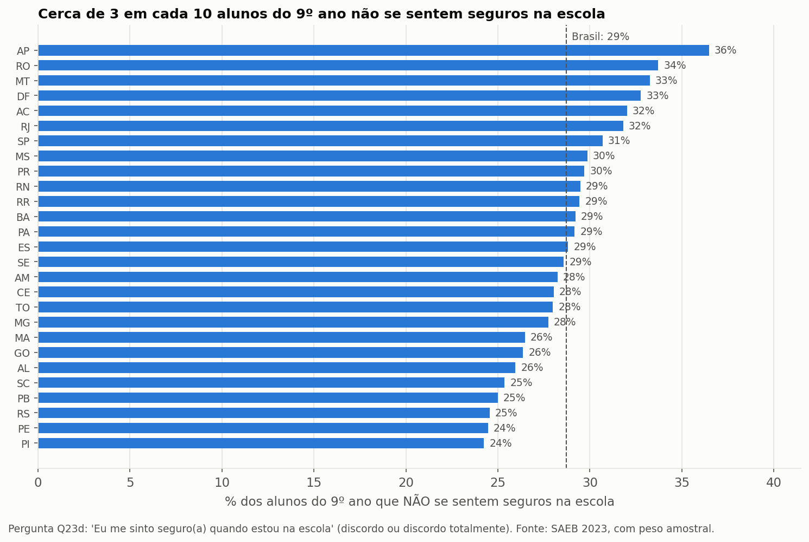
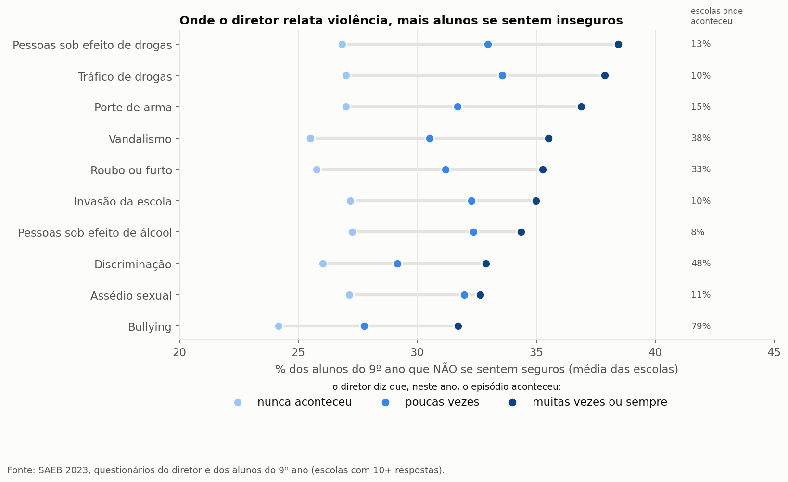
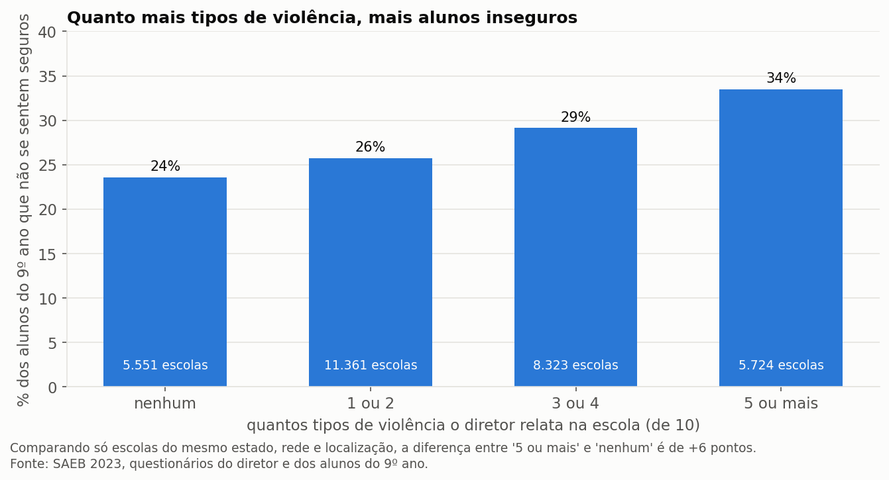
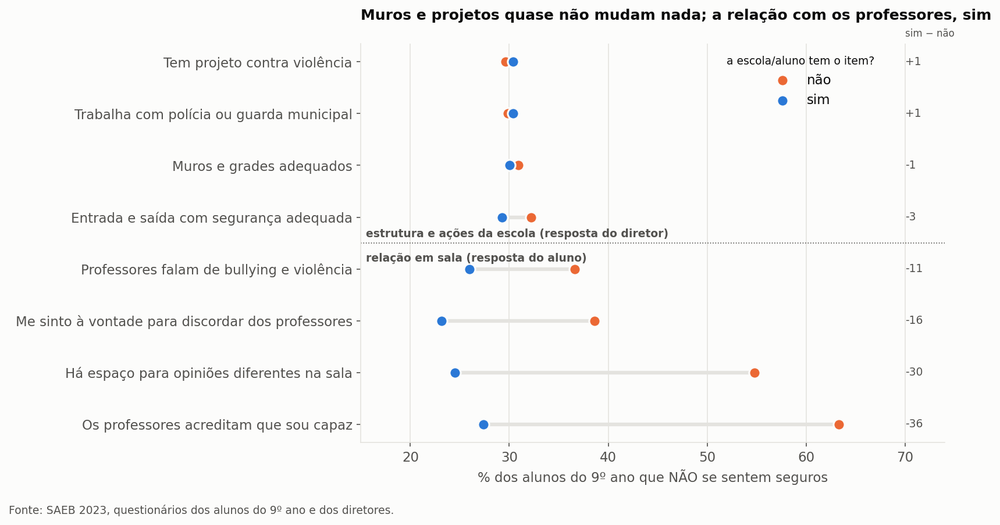

# Segurança na escola

**Pergunta:** os alunos se sentem seguros na escola? O que está ligado a isso?

**Resposta curta:** cerca de 3 em cada 10 alunos do 9º ano não se sentem seguros na escola. A violência relatada por diretores e professores está ligada a isso. Mas o que mais acompanha a sensação de segurança é a **relação em sala** com os professores, não muros, polícia ou projetos.

Análise feita no notebook `seguranca_escola.ipynb`. Figuras e tabelas na pasta `resultados_seguranca/`.

## Dados
Três questionários do SAEB 2023, ligados pelo código da escola (`ID_ESCOLA`):

| Tabela | Colunas | Respostas |
|---|---|---|
| Alunos | `TX_RESP_Q23d` "Eu me sinto seguro(a) quando estou na escola" (**resultado**: discorda = não se sente seguro) | 1,94 mi (5º) · 2,00 mi (9º) · 1,47 mi (3ª EM) |
| | `TX_RESP_Q22f` professores falam de bullying · `Q23c` espaço para opiniões · `Q23e` à vontade para discordar · `Q23h` professores acreditam que sou capaz | ~2,0 mi no 9º |
| Diretores | `TX_Q093`–`TX_Q102` frequência de 10 tipos de violência · `Q082` aulas interrompidas por violência · `Q104` entrada/saída · `Q105` muros/grades · `Q123` polícia/guarda · `Q196` projeto contra violência | 61.870 escolas |
| Professores | `TX_Q135`–`TX_Q147` frequência de violência, incluindo lesão corporal e tiroteio | 128 mil professores do 9º ano |

- Não usamos nota e não comparamos alunos por cor, sexo ou renda. As comparações são entre **escolas** e **o que acontece nelas**.
- O questionário do diretor aparece uma vez por série avaliada. Deixamos **uma linha por escola**.
- Nas partes 2 e 3 cada escola é uma unidade: usamos a % de alunos do 9º ano que não se sentem seguros, em ~31 mil escolas com 10 ou mais respostas.

## 1. Quantos não se sentem seguros

| Série | % não se sente seguro | % discorda totalmente |
|---|---|---|
| 5º ano | 19,8% | 6,9% |
| 9º ano | **28,7%** | 7,9% |
| 3ª série EM | 25,5% | 6,4% |

- Entre os estados, vai de ~24% (PI, PE) a ~36% (AP). DF, RJ e SP ficam acima da média.
- Escola pública: 31%; privada: 18%. Urbana: 29%; rural: 24%.
- Em 5% das escolas, **metade ou mais** dos alunos não se sente segura.

## 2. A violência relatada pelo diretor

- Em **todos** os 10 tipos de violência, a insegurança dos alunos sobe conforme o episódio fica mais frequente. Os maiores saltos são em drogas, tráfico e porte de arma: de ~27% (nunca aconteceu) para ~37–38% (muitas vezes).
- Episódios graves "frequentes" são raros (porte de arma 0,2% das escolas, tráfico 1%). Mas **acontecer pelo menos uma vez** é comum: roubo em 33% das escolas, discriminação em 48%, bullying em 79%.

| Tipos de violência relatados (de 10) | Escolas | % alunos inseguros | Diferença em escolas parecidas* |
|---|---|---|---|
| nenhum | 5.551 | 23,6% | — |
| 1 ou 2 | 11.361 | 25,8% | +0,8 |
| 3 ou 4 | 8.323 | 29,1% | +2,8 |
| 5 ou mais | 5.724 | 33,5% | **+6,1** |

\* comparando só escolas do mesmo estado, mesma rede (pública/privada) e mesma localização (urbana/rural).

## 3. O que os professores relatam
A visão dos professores confirma a dos diretores. Escolas onde **metade ou mais** dos professores do 9º ano relatam o episódio, comparadas com escolas onde nenhum relata:

| Episódio | Escolas onde algum professor relata | % inseguros: nenhum relata | % inseguros: metade ou mais |
|---|---|---|---|
| Tráfico de drogas | 24% | 25,9% | 33,1% |
| Roubo ou furto | 58% | 23,7% | 30,7% |
| Vandalismo | 65% | 23,4% | 30,0% |
| Lesão corporal | 60% | 24,0% | 30,1% |
| Tiroteio ou bala perdida | 4% (~1.200 escolas) | 27,3% | 33,3% |
| Bullying | 93% | 22,5% | 28,0% |

## 4. Estrutura da escola × relação em sala

| Item | % dos alunos com o item | Inseguros: sim | Inseguros: não | Diferença na mesma escola |
|---|---|---|---|---|
| Escola tem projeto contra violência | 96% | 30,4% | 29,6% | — |
| Escola trabalha com polícia/guarda | 85% | 30,4% | 29,8% | — |
| Muros e grades adequados | 68% | 30,1% | 30,9% | — |
| Entrada e saída com segurança adequada | 64% | 29,3% | 32,2% | — |
| Professores falam de bullying e violência | 58% | 26,0% | 36,6% | −9,6 |
| À vontade para discordar dos professores | 53% | 23,1% | 38,6% | −15,2 |
| Há espaço para opiniões diferentes | 81% | 24,5% | **54,8%** | −28,1 |
| Os professores acreditam que sou capaz | 92% | 27,4% | **63,3%** | −33,4 |

- **Estrutura e ações quase não fazem diferença.** Projeto contra violência, polícia e muros não aparecem ligados a alunos mais seguros. Só a segurança na entrada e saída tem uma diferença pequena (3 pontos).
- **A relação em sala faz muita diferença.** Entre os alunos que acham que os professores **não** acreditam neles, 63% não se sentem seguros. Entre os demais, 27%.
- A diferença **continua quase igual entre alunos da mesma escola**. Então não é só que algumas escolas são melhores: dentro da mesma escola, quem tem uma relação pior com os professores se sente menos seguro.

## Conclusões
1. **Cerca de 3 em cada 10** alunos do 9º ano não se sentem seguros na escola; no 5º ano são 2 em cada 10.
2. **A violência pesa.** Onde diretor e professores relatam mais violência, mais alunos se sentem inseguros, mesmo comparando escolas do mesmo estado, rede e localização.
3. **Muros, polícia e projetos quase não aparecem ligados à sensação de segurança.** Quase todas as escolas dizem ter projeto contra violência, e isso não diferencia nada.
4. **O que mais acompanha a sensação de segurança é a relação com os professores:** sentir que acreditam no aluno, ter espaço para opinar e falar sobre bullying em sala.

## Limitações
- "Me sentir seguro" e "os professores acreditam em mim" são respostas do **mesmo aluno**. Quem está insatisfeito com a escola tende a responder mal nas duas. Por isso é associação, não prova de causa.
- ~20% dos alunos deixaram a pergunta de segurança em branco.
- Violência relatada é a **percepção** de diretores e professores, não registro policial. Escolas diferentes podem ter critérios diferentes do que é "muitas vezes".
- O código da escola é mascarado, então não dá para cruzar com outros dados (Censo Escolar, ocorrências policiais).

## Fonte
- Microdados SAEB 2023 — https://www.gov.br/inep/pt-br/acesso-a-informacao/dados-abertos/microdados/saeb
